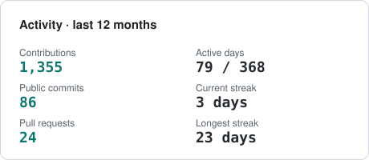
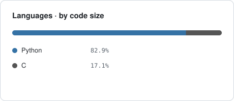
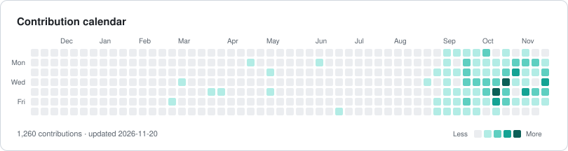

  

  
  
  

### About

I build the full loop of a systematic trading idea: capture the data, state the hypothesis before
looking at results, test it honestly after costs, and run it on infrastructure I set up myself.

- **Now:** student at 42 Paris (AI track: Python, C), moving into **C++ and Rust** for low-latency work.
- **Research style:** pre-registered hypotheses, frozen contracts, sealed test sets, results reported even when they say "no edge".
- **Before 42:** systems analyst at Allianz (AGCS), then a decade in business development and web project management; MBA.
- **Community:** community manager at 42 AI.

### Featured work

<table>
<tr>
<td width="50%" valign="top">

<b><a href="https://github.com/balasbrn/llm-veto-distillation">llm-veto-distillation</a></b> 
Can a 3 ms model copy an LLM's trade veto, and is the veto worth copying? Students reach κ ≈ 0.4–0.5 against a Gemini teacher, and the project keeps "copies the teacher" apart from "makes money". 
Python · scikit-learn · Vertex AI · triple-barrier labels

</td>
<td width="50%" valign="top">

<b><a href="https://github.com/balasbrn/ATR_breakout_strategy">ATR_breakout_strategy</a></b> 
One volatility-breakout idea tested across US stocks, NSE, crypto and FX/gold, with a frozen, versioned contract: gross edge first, then after costs. 
Python · pre-registration · transaction costs · multi-market

</td>
</tr>
<tr>
<td width="50%" valign="top">

<b><a href="https://github.com/balasbrn/llm-compression-lab-notes">llm-compression-lab-notes</a></b> 
Pruning, distillation and serving benchmarks on Llama 3.2 3B: ~20% fewer parameters with throughput and latency gains. NVIDIA DLI assessment 100/100. 
NAS pruning · knowledge distillation · inference benchmarking

</td>
<td width="50%" valign="top">

<b><a href="https://github.com/balasbrn/google-cloud-ace-study">google-cloud-ace-study</a></b> 
Public study log for the Google Cloud Associate Cloud Engineer exam: decision tables, commands, AWS comparisons and tracked weak spots. 
GCP · IAM · GCS · Compute Engine

</td>
</tr>
</table>

<b>In the lab</b>: private research systems, being prepared for public release

 

| Project | What it does | Stack |
|---|---|---|
| Unified Quant Platform | Multi-broker data ingestion (IBKR, cTrader, Zerodha, Bybit) into a leak-checked data lake, pluggable signal modules and paper-only shadow tracking | Python, Polars, DuckDB, BigQuery |
| Execution research workspace | cTrader cBots and IBKR paper trading, with baselines kept separate from experiments | C#, Python, IBKR |
| Stock shadow bot | Single-stock paper bot on a 15-minute Cloud Run schedule, with IBKR execution, econometric features and log telemetry | Python, Cloud Run, IBKR |
| OHLCV research assistant | Validated bar data, deterministic signals, optional FinBERT sentiment, vectorised backtests | Python, pandas, PyTorch |
| Trade storyboard | Per-stock trade-study dashboard for exploring high-frequency study events | React, Vite, TypeScript |
| C library from scratch ([libft](https://github.com/balasbrn/library-functions-in-C)) | 42 core project: libc, memory, string and linked-list functions | C |

### Stack

  
  
  
  
  
  
   
  
  
  
  
  
   
  
  
  
  
  
  
   
  
  
  

### Certifications

| | Certification | Status |
|---|---|---|
|  | **The Art of Compressing LLMs**: pruning, distillation and quantization (DLI Certificate of Competency) | Nov 2026 · 100/100 · [verify](https://learn.nvidia.com/certificates?id=5GdXy5BkQyKAFXkroo0lyw) |
|  | **Associate Cloud Engineer** | In progress · [study log](https://github.com/balasbrn/google-cloud-ace-study) |

### Activity

  <picture>
    <source media="(prefers-color-scheme: dark)" srcset="assets/generated/stats-dark.svg">
    
  </picture>
  <picture>
    <source media="(prefers-color-scheme: dark)" srcset="assets/generated/languages-dark.svg">
    
  </picture>

<picture>
  <source media="(prefers-color-scheme: dark)" srcset="assets/generated/activity-dark.svg">
  
</picture>

<picture>
  <source media="(prefers-color-scheme: dark)" srcset="assets/generated/snake-dark.svg">
  
</picture>

Cards are rendered daily by a GitHub Action in this repo (<code>scripts/build_cards.py</code>) and served from it, with no third-party stats service.
